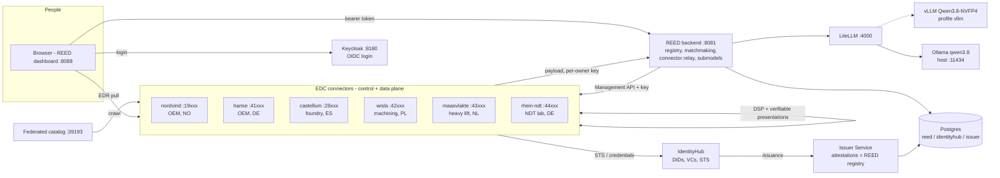

# REED - a European manufacturing data space with matchmaking

REED is a **sovereign data space for large industrial parts**: wind-turbine hubs, ship hull
blocks, bogie frames, press frames, Francis runners, penstocks. OEMs post requests for
quotation (RFQs); REED **matches them to qualified suppliers** with an explainable score; the
buyer then **contracts over Eclipse Dataspace Connector (EDC)** for the supplier's confidential
process capability before the match is confirmed.

The core rule never changes: **you can discover that data exists, but you receive the payload
only after a contract** - and every connector proves who it is with **verifiable credentials**.

| | |
|---|---|
| **Connectors** | 6 EDC `0.17.0` connectors (control + data plane), one per company, plus a federated catalog |
| **Identity for organisations** | Decentralized Claims Protocol (DCP): IdentityHub, REED Issuer Service, `did:web`, Membership / Certification / SupplierRelation credentials. EDC policies are CEL rules over those credentials |
| **Identity for people** | Keycloak (OIDC, PKCE): roles `buyer`, `supplier-engineer`, `quality-auditor`, `admin`; the token carries the user's organisation |
| **Matchmaking** | Hard filters + six weighted criteria (lead time, tolerance margin, logistics for bulky parts, track record, sector, embedded CO2 for CBAM) with per-criterion explanations, partner recommendations and a contract-backed match lifecycle |
| **Assistant** | Local LLM only: **Qwen3.8** via **LiteLLM**, routed to **Ollama** (default) or **vLLM**; personal data is redacted, scores come from the scorer |
| **Real cases** | 9 RFQs across wind, shipbuilding/offshore, rail/heavy machinery and hydropower, 15 fictional European companies in real EU industrial clusters |

> Demo-grade infrastructure: dev-mode Vault (in-memory), in-memory connector stores, no TLS,
> one shared IdentityHub. Everything the data space *means* (credentials, policies, contracts,
> audit) is real; see [Production gaps](#production-gaps).

## Topology



The browser never holds a connector key: it calls the REED backend with the user's token, and the
backend relays Management API calls to **the user's own organisation's connector** only.

## Quickstart

Prerequisites: JDK 17, Docker with Compose v2, `curl`, `jq`, `openssl`, Python 3. For the
assistant: [Ollama](https://ollama.com) on the host with `ollama pull qwen3.8` (without it the
assistant falls back to deterministic rules and says so).

```bash
# 1. Generate the topology from the roster (configs, compose file, realm, keys, secrets in deployment/.env)
python3 tools/gen_topology.py

# 2. Build the runtimes (connector, federated catalog, IdentityHub, Issuer Service, backend)
./gradlew :launchers:connector:shadowJar :launchers:federated-catalog:shadowJar \
          :launchers:identity-hub:shadowJar :launchers:issuerservice:shadowJar \
          :services:reed-backend:bootJar

# 3. Start everything (add --profile vllm to also serve Qwen3.8 with vLLM on an NVIDIA GPU)
docker compose -f deployment/docker-compose.yml up --build -d

# 4. Identity: DIDs + verifiable credentials for every member, then EDC offers per owner
./seed-identity.sh
./seed-reed.sh

# 5. Verify end to end
./run-transfer.sh        # DCP contract + EDR pull, and two credential-based refusals
./run-matchmaking.sh     # all 9 real-case scenarios, full lifecycle where both sides run a connector
(cd services/reed-dashboard && npm ci && npx playwright install chromium && npx playwright test)
```

Open **http://localhost:8088** and log in (password for every demo user: `reed-demo`):

| User | Organisation | Try this |
|---|---|---|
| `nordvind-buyer` | Nordvind Energy Systems (OEM, Stavanger NO) | Matches → R1 rotor hub: shortlist Castellum, later *Request capability via contract* |
| `hanse-buyer` | Hanse Marine & Rail (OEM, Kiel DE) | R4 jacket node, R6 bogie frame |
| `castellum-engineer` | Castellum Fundición (foundry, Bilbao ES) | Opportunities: accept the shortlist |
| `wisla-engineer` | Wisła Precision Machining (Gdańsk PL) | Opportunities: R2 bearing ring |
| `rhein-auditor`, `maasvlakte-engineer` | service providers | partner recommendations, audit |
| `nordvind-quality` | Nordvind | audit trail of its own organisation |
| `vagant-buyer` | Vagant Components (**not** a member) | sees nothing, cannot post |
| `reed-admin` | dataspace operator | every view, any member's catalogue |

Teardown: `docker compose -f deployment/docker-compose.yml down -v` (the `-v` drops Vault and
Postgres; after it, run steps 3-4 again).

## The real-case scenarios

`deployment/scenarios/matchmaking.json` - each RFQ documents its expected winner and rejections,
asserted by `ScenarioFixtureTest` and `run-matchmaking.sh`.

| | Chain | RFQ | Top match | Why others fail |
|---|---|---|---|---|
| R1 | Wind | Rotor hub casting, EN-GJS-400-18-LT, 38 t, DNV | Castellum (Bilbao) | Śląsk: too large, too heavy, DNV only self-declared |
| R2 | Wind | Tower flange / yaw bearing ring Ø6.5 m | Wisła (Gdańsk) | Sachsen, Tirrene: lathe too small |
| R3 | Offshore | Hull block 18×14×8 m, 280 t, DNV + ISO 3834-2 | Odense Steel Blocks | Ebro: no block fabrication, too small, too heavy |
| R4 | Offshore | Jacket cast node, G20Mn5 | Castellum | Śląsk: material |
| R5 | Offshore | Propeller shaft forging, 34CrNiMo6 | Acciaierie Tirrene (Piombino) | Wisła: no forging |
| R6 | Rail | Welded bogie frame ×300, EN 15085-2 | Sachsen (Chemnitz), then Ebro | Odense: no milling, no EN 15085-2 |
| R7 | Heavy machinery | Hydraulic press frame, 95 t, EN 1090 EXC3 | Ebro (Zaragoza) | Sachsen: no heat treatment, too heavy |
| R8 | Hydro | Francis runner, GX4CrNi13-4 | Castellum (+ Rhein NDT, Wisła as partners) | Śląsk: material |
| R9 | Hydro | Penstock to a fjord site | Odense, then Atlantique (Saint-Nazaire) | Ebro: no plate rolling |

All companies are **fictional** European companies placed in real industrial clusters; VAT ids are
illustrative. Nothing here describes a real firm.

## Repository layout

```
deployment/roster.json              single source of truth: participants, capabilities, credentials, users
deployment/scenarios/matchmaking.json   the 9 real-case RFQs + expected outcomes
tools/gen_topology.py               roster -> compose file, connector/identity configs, realm, keys, .env
tools/reed-lib.sh                   shared helpers for the shell scripts
seed-identity.sh / seed-reed.sh     DCP identity seeding / per-owner EDC seeding
run-transfer.sh / run-matchmaking.sh    end-to-end verification
services/reed-backend/              Spring Boot: registry, matchmaking, assistant, BFF, submodels (Flyway)
services/reed-dashboard/            React + Vite SPA, Keycloak login, Playwright e2e tests
launchers/{connector,federated-catalog,identity-hub,issuerservice}/   EDC 0.17.0 runtimes
extensions/{http-pull-proxy,static-node-directory,superuser-seed}/    small EDC extensions
docs/                               architecture, identity, matchmaking, data model, operations
```

## Documentation

- [docs/matchmaking.md](docs/matchmaking.md) - scoring, lifecycle, scenarios, the assistant and its guardrails
- [docs/identity-and-trust.md](docs/identity-and-trust.md) - Keycloak, DIDs, credentials, CEL policies, the relay
- [docs/reed-data-model.md](docs/reed-data-model.md) - tables, asset classes, the three policy layers
- [docs/connectors-and-protocols.md](docs/connectors-and-protocols.md) - ports, endpoints, who talks to whom
- [docs/add-participant.md](docs/add-participant.md) - onboarding a company (edit the roster, regenerate)
- [docs/dashboard-guide.md](docs/dashboard-guide.md) - a walkthrough of the UI
- [RUN.md](RUN.md) - operations: rebuilds, troubleshooting

## Production gaps

Deliberate shortcuts, each marked `ponytail:` in code where it lives:

- **One shared IdentityHub** holds every member's keys (one trust domain). Production: one hub per
  member, or a hosted wallet per member.
- **Dev-mode Vault and in-memory connector stores**: a restart means re-running the seed scripts.
  Production: Vault with storage + the EDC SQL BOMs.
- **No TLS**, `did:web` over plain http inside Docker.
- **Delimited-string credential claims** (`,ISO9001,DNV,`) keep the issuer's database attestations
  simple; JSON-array claims would be cleaner.
- **The submodel store is shared** by all owners (each owner has its own key). Production: each
  member serves its own payloads.
- **Usage-layer duties** (no redistribution, delete after expiry) are recorded and audited, not
  technically enforced after the payload leaves the provider.
