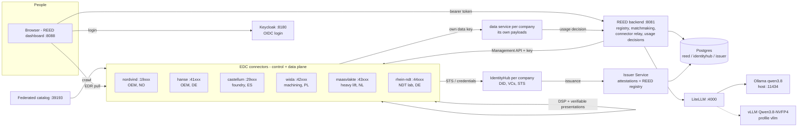

# REED - a European manufacturing data space with matchmaking

REED is a **sovereign data space for large industrial parts**: wind-turbine hubs, ship hull
blocks, bogie frames, press frames, Francis runners, penstocks. OEMs post requests for
quotation (RFQs); REED **matches them to qualified suppliers** with an explainable score; the
buyer then **contracts over Eclipse Dataspace Connector (EDC)** for the supplier's confidential
process capability before the match is confirmed.

The core rule never changes: **you can discover that data exists, but you receive the payload
only after a contract** - and every connector proves who it is with **verifiable credentials**.

| | |
|---|---|
| **Connectors** | 7 EDC `0.17.0` connectors (control + data plane, Postgres-backed stores), one per company, plus a federated catalog |
| **Identity for organisations** | Decentralized Claims Protocol (DCP): **one IdentityHub per company**, a REED Issuer Service, `did:web`, Membership / Certification / SupplierRelation credentials. EDC policies are CEL rules over those credentials. Secrets in a persistent Vault, each company confined to its own folder |
| **Identity for people** | Keycloak (OIDC, PKCE): roles `buyer`, `supplier-engineer`, `quality-auditor`, `data-steward` (sets its organisation's data terms), `admin`; the token carries the user's organisation |
| **Matchmaking** | Hard filters + six weighted criteria (lead time, tolerance margin, logistics for bulky parts, track record, sector, embedded CO2 for CBAM) with per-criterion explanations, partner recommendations and a contract-backed match lifecycle |
| **Sovereign terms** | Each owner sets, per asset, who finds it and who may sign - role, registered seat (EU / EEA), certification, supply relation, shared project - and publishes it to its own connector from the **Data space** view; nobody else (not the operator) can change it. REED predicts who gets what; `run-interop.sh` checks every connector pair agrees |
| **Shop floor** | Each company's (simulated) line publishes sensors over MQTT; REED analyses trends every minute, tags operators' notes with the LLM, briefs the shift. A "toy factory": inject a fault or maintain a machine from the dashboard and watch the alarm arise and clear. A supplier's live line state reaches a customer only inside its production-status payload, under contract |
| **Assistant** | Every LLM call goes through **LiteLLM**: local **Qwen3.8** on **Ollama** (default) or **vLLM**; frontier APIs (Anthropic, Mistral, OpenAI) opt-in with a key. Personal data is redacted before any call; scores come from the scorer |
| **Real cases** | 11 RFQs across wind, shipbuilding/offshore, rail/heavy machinery (incl. mining shovels) and hydropower; 15 fictional European companies in real EU industrial clusters plus Komatsu Mining Germany as an illustrative buyer |

> State survives restarts: Vault (file storage, auto-unsealed), every connector, IdentityHub,
> the issuer, Keycloak and the REED registry persist in Postgres - `run-persistence.sh` proves it.
> Remaining gaps (mainly TLS) are listed under [Production gaps](#production-gaps).

## Topology



The browser never holds a connector key: it calls the REED backend with the user's token, and the
backend relays Management API calls to **the user's own organisation's connector** only.

## Quickstart

Prerequisites: JDK 17, Docker with Compose v2, `curl`, `jq`, `openssl`, Python 3. For the
assistant: [Ollama](https://ollama.com) on the host with `ollama pull qwen3.8` (without it the
assistant falls back to deterministic rules and says so).

```bash
# 1. Generate the topology from the roster (configs, compose file, realm, keys, secrets in deployment/.env)
python3 tools/gen_topology.py

# 2. Build the runtimes (connector, federated catalog, IdentityHub, Issuer Service, backend)
./gradlew :launchers:connector:shadowJar :launchers:federated-catalog:shadowJar \
          :launchers:identity-hub:shadowJar :launchers:issuerservice:shadowJar \
          :services:reed-backend:bootJar

# 3. Start everything (add --profile vllm to also serve Qwen3.8 with vLLM on an NVIDIA GPU)
docker compose -f deployment/docker-compose.yml up --build -d

# 4. Identity: DIDs + verifiable credentials for every member, then EDC offers per owner
./seed-identity.sh
./seed-reed.sh

# 5. Verify end to end
./run-transfer.sh        # DCP contract + EDR pull, and two credential-based refusals
./run-matchmaking.sh     # all 11 scenarios, full lifecycle where both sides run a connector
./run-persistence.sh     # full stop/start without wiping volumes: nothing needs re-seeding
./run-factory.sh         # shop floor: MQTT ACLs, live stream, observations, briefing, fault -> alarm -> maintenance
./run-interop.sh         # every company x every company: catalogues + contracts as predicted, 8 cross-border stories
(cd services/reed-dashboard && npm ci && npx playwright install chromium && npx playwright test)
```

Open **http://127.0.0.1:8088** (an IP, so a browser that once saw HSTS for `localhost` does not force https) and log in (password for every demo user: `reed-demo`):

| User | Organisation | Try this |
|---|---|---|
| `nordvind-buyer` | Nordvind Energy Systems (OEM, Stavanger NO) | Matches → R1 rotor hub: shortlist Castellum, later *Request capability via contract* |
| `hanse-buyer` | Hanse Marine & Rail (OEM, Kiel DE) | R4 jacket node, R6 bogie frame |
| `komatsu-buyer` | Komatsu Mining Germany (illustrative, Düsseldorf DE) | K1 swing-circle carrier: full contract with Castellum |
| `castellum-engineer` | Castellum Fundición (foundry, Bilbao ES) | Opportunities: accept the shortlist. **Data space**: set the process capability to `eu-member-states`, see Nordvind (NO) flip to refused, publish. **Factory → Line controls**: inject a spike |
| `wisla-engineer` | Wisła Precision Machining (Gdańsk PL) | Opportunities: R2 bearing ring |
| `rhein-auditor`, `maasvlakte-engineer` | service providers | partner recommendations, audit |
| `nordvind-quality` | Nordvind | audit trail of its own organisation |
| `vagant-buyer` | Vagant Components (**not** a member) | sees nothing, cannot post |
| `reed-admin` | dataspace operator | every view, any member's catalogue; Data space *Look as* any company (cannot change its terms) |

Stop with `docker compose -f deployment/docker-compose.yml down` and start again with `up -d` -
no seeding needed. `down -v` wipes Vault and Postgres (then run steps 3-4 again). Every published
port is bound to `127.0.0.1`.

## The real-case scenarios

`deployment/scenarios/matchmaking.json` - each RFQ documents its expected winner and rejections,
asserted by `ScenarioFixtureTest` and `run-matchmaking.sh`.

| | Chain | RFQ | Top match | Why others fail |
|---|---|---|---|---|
| R1 | Wind | Rotor hub casting, EN-GJS-400-18-LT, 38 t, DNV | Castellum (Bilbao) | Śląsk: too large, too heavy, DNV only self-declared |
| R2 | Wind | Tower flange / yaw bearing ring Ø6.5 m | Wisła (Gdańsk) | Sachsen, Tirrene: lathe too small |
| R3 | Offshore | Hull block 18×14×8 m, 280 t, DNV + ISO 3834-2 | Odense Steel Blocks | Ebro: no block fabrication, too small, too heavy |
| R4 | Offshore | Jacket cast node, G20Mn5 | Castellum | Śląsk: material |
| R5 | Offshore | Propeller shaft forging, 34CrNiMo6 | Acciaierie Tirrene (Piombino) | Wisła: no forging |
| R6 | Rail | Welded bogie frame ×300, EN 15085-2 | Sachsen (Chemnitz), then Ebro | Odense: no milling, no EN 15085-2 |
| R7 | Heavy machinery | Hydraulic press frame, 95 t, EN 1090 EXC3 | Ebro (Zaragoza) | Sachsen: no heat treatment, too heavy |
| R8 | Hydro | Francis runner, GX4CrNi13-4 | Castellum (+ Rhein NDT, Wisła as partners) | Śląsk: material |
| R9 | Hydro | Penstock to a fjord site | Odense, then Atlantique (Saint-Nazaire) | Ebro: no plate rolling |
| K1 | Mining machinery | Cast swing-circle carrier, G20Mn5, 18 t *(Komatsu, illustrative)* | Castellum (+ Rhein NDT for UT) | Śląsk: material |
| K2 | Mining machinery | Welded boom, S460NL, 38 t, EN 1090 EXC3 *(Komatsu, illustrative)* | Ebro (+ Maasvlakte for heavy lift) | Sachsen: no heat treatment, no EN 1090 EXC3; Atlantique: no milling/heat treatment |

All companies are **fictional** European companies placed in real industrial clusters; VAT ids are
illustrative. The one exception is **Komatsu Mining Germany GmbH** (Düsseldorf), added on request as an
**illustrative buyer**: K1 and K2 are invented scenarios, not actual Komatsu purchases, and no
certifications, capabilities, registrations or relations are claimed for it (the dashboard labels it).

## LLM routing

The backend talks to one OpenAI-compatible endpoint, LiteLLM, by the alias in `REED_LLM_MODEL`
(default `reed-llm`, local Qwen3.8). To use a frontier model instead, add its key and the alias to
`deployment/.env` (kept across `gen_topology.py` runs) and recreate LiteLLM and the backend:

```bash
echo 'MISTRAL_API_KEY=...'         >> deployment/.env   # or ANTHROPIC_API_KEY / OPENAI_API_KEY
echo 'REED_LLM_MODEL=reed-llm-mistral' >> deployment/.env  # reed-llm-claude / reed-llm-openai
docker compose -f deployment/docker-compose.yml up -d litellm reed-backend
```

Routes live in `deployment/litellm/config.yaml`; a frontier route falls back to the local model if it
fails. Whatever the route, REED sends organisation and part data only (personal data is redacted
first), and every number in an answer must come from REED's own data or the answer is discarded. Operators' free-text
shop-floor notes (which may name colleagues) are tagged by a local model only; on a frontier route they are
tagged by rules.

## Repository layout

```
deployment/roster.json              single source of truth: participants, capabilities, credentials, users
deployment/scenarios/matchmaking.json   the 11 RFQs + expected outcomes
deployment/scenarios/interop.json   8 cross-border data-sharing stories (owner terms -> who gets a contract)
tools/gen_topology.py               roster -> compose file, connector/identity configs, realm, keys, .env
tools/reed-lib.sh                   shared helpers for the shell scripts
seed-identity.sh / seed-reed.sh     DCP identity seeding / per-owner EDC seeding
run-transfer.sh / run-matchmaking.sh / run-interop.sh / run-factory.sh / run-persistence.sh    end-to-end verification
services/reed-backend/              Spring Boot: registry, matchmaking, assistant, BFF, usage decisions (Flyway)
services/data-service/              each company's payload service (stdlib Python): licence + watermark
services/factory-sim/               each line's simulated devices (stdlib Python + paho-mqtt): readings, faults, maintenance
services/reed-dashboard/            React + Vite SPA, Keycloak login, Playwright e2e tests
launchers/{connector,federated-catalog,identity-hub,issuerservice}/   EDC 0.17.0 runtimes
extensions/{http-pull-proxy,static-node-directory,superuser-seed}/    small EDC extensions
docs/                               architecture, identity, matchmaking, data model, operations
```

## Documentation

- [docs/matchmaking.md](docs/matchmaking.md) - scoring, lifecycle, scenarios, the assistant and its guardrails
- [docs/identity-and-trust.md](docs/identity-and-trust.md) - Keycloak, DIDs, credentials, CEL policies, the relay
- [docs/reed-data-model.md](docs/reed-data-model.md) - tables, asset classes, the three policy layers
- [docs/connectors-and-protocols.md](docs/connectors-and-protocols.md) - ports, endpoints, who talks to whom
- [docs/add-participant.md](docs/add-participant.md) - onboarding a company (edit the roster, regenerate)
- [docs/dashboard-guide.md](docs/dashboard-guide.md) - a walkthrough of the UI
- [RUN.md](RUN.md) - operations: rebuilds, troubleshooting

## Production gaps

What is production-style today: per-company IdentityHubs and Vault folders, persistent Vault and
stores, Keycloak in production mode on Postgres, generated secrets (`deployment/.env`), admin APIs
and databases bound to localhost, key-protected Management APIs behind a user-scoped relay,
credential-based EDC policies, Management API v4 with EDRs delivered by callback, each company
serving its own payloads under licence (usage decided per pull, pilot licences expire, watermarked)
and an audit trail naming who received each payload.

Deliberate remaining shortcuts, each marked `ponytail:` in code where it lives:

- **No TLS.** Everything is plain http on one host (`did:web` resolution included). Production:
  certificates on every endpoint (`edc.iam.did.web.use.https=true`), Keycloak `KC_HTTPS_*`.
- **Vault unseal key and token ids**: the root token is revoked right after bootstrap (no root token
  exists afterwards), but the unseal key stays in a local volume - removing it needs auto-unseal
  against an external KMS/HSM. Tokens use fixed ids from `.env` (Vault hashes those with SHA-1).
  Production: auto-unseal and AppRole/Kubernetes auth.
- **One host, one Vault server, one Postgres** for all companies (isolated by Vault policy and
  separate databases). Production: each company runs its own connector, IdentityHub and secrets.
- **Delimited-string credential claims** (`,ISO9001,DNV,`) keep the issuer's database attestations
  simple; JSON-array claims would be cleaner.
- **Usage after release**: the owner's data service enforces the licence at release time (contract
  agreement required, pilot licences expire) and stamps every payload with its licence and a
  watermark that attributes leaked copies; what a consumer does with a copy afterwards (deleting it
  at expiry, not redistributing) cannot be technically enforced without trusted execution - it is
  licensed, traceable and audited.
- **Credential status checks**: if an IdentityHub cannot reach the issuer's status list, EDC
  marks the credentials ERROR and does not recover them; startup ordering prevents it, and
  `./seed-identity.sh` re-issues any credential that is not ISSUED.
